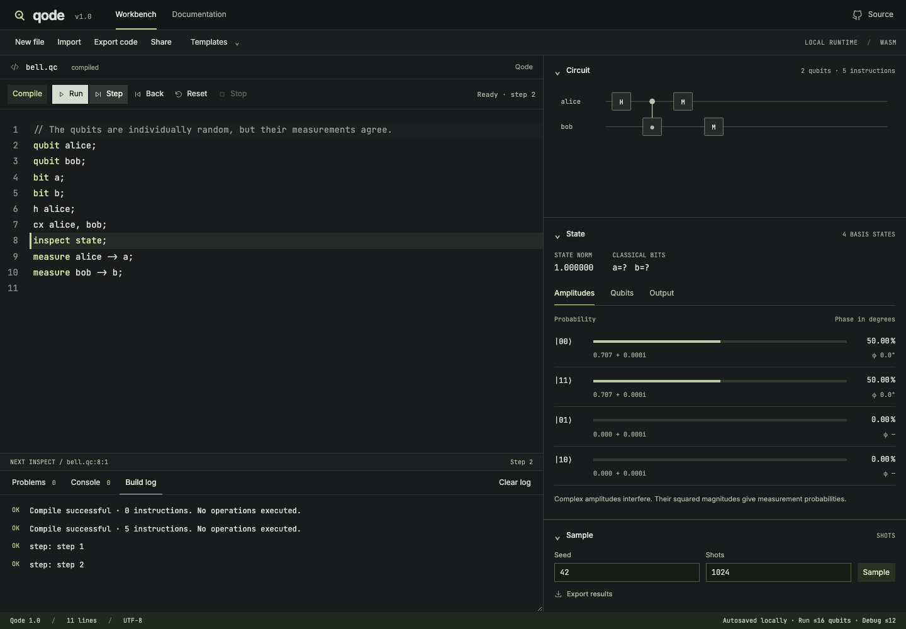
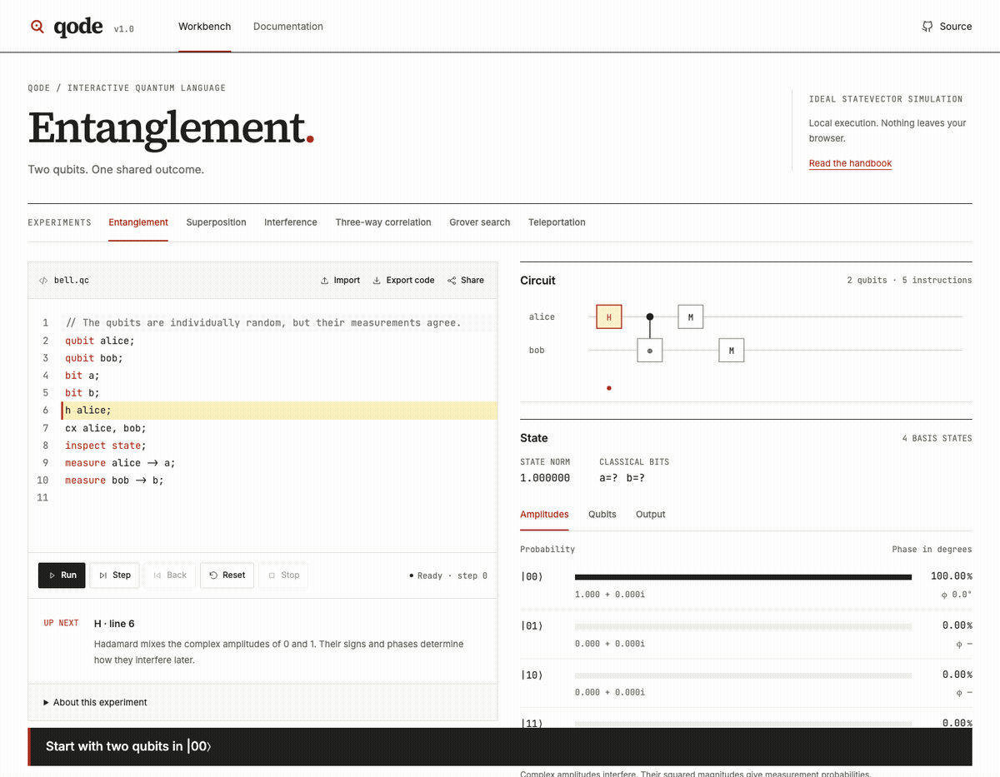
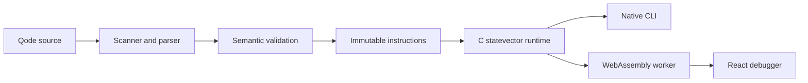
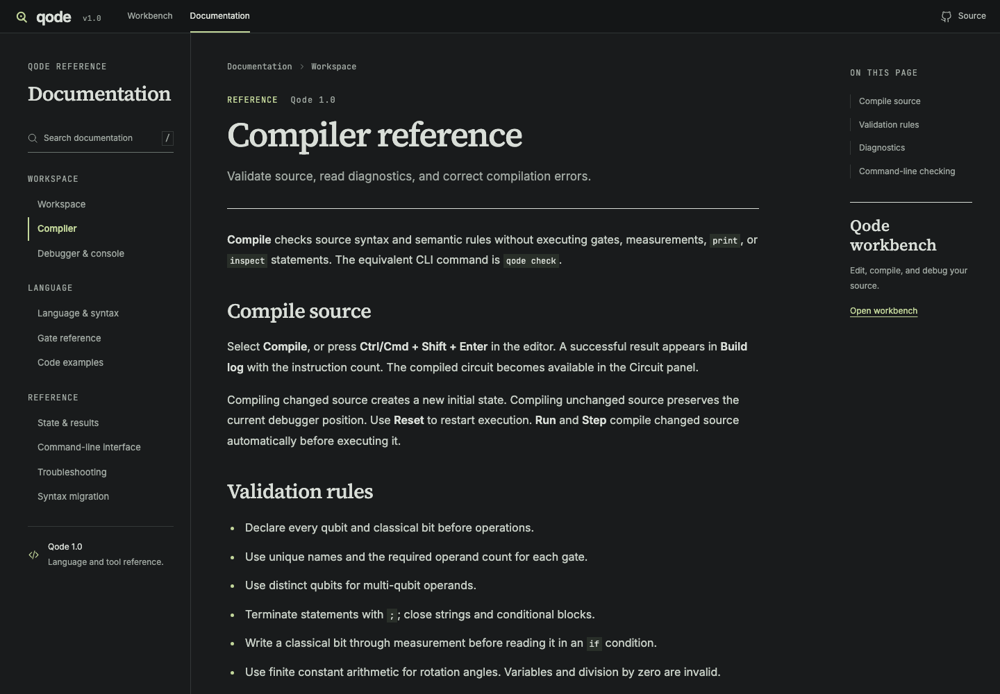

# Qode

**A quantum language with a browser IDE and a C11 runtime.**

**[Try it](https://qode-olive.vercel.app/)** · **[Run locally](#browser-playground)** · **[Read the architecture](docs/ARCHITECTURE.md)**

[Handbook](https://qode-olive.vercel.app/docs/) · [Verification runs](https://github.com/devenshah2018/qode/actions/workflows/ci.yml)

Write a readable circuit, step through its complex amplitudes, and see how interference and measurement produce an outcome. Qode pairs a dependency-free C11 engine with a native CLI and an account-free WebAssembly playground.



```text
qubit alice;
qubit bob;
bit a;
bit b;

h alice;
cx alice, bob;
inspect state;
measure alice -> a;
measure bob -> b;
```

The joint state is `( |00⟩ + |11⟩ ) / √2`. Sampling produces only `00` and `11`: each qubit is individually random, but their measurements agree.

## A circuit, one step at a time



Choose **Templates → Entanglement** in the [IDE](https://qode-olive.vercel.app/), then press **Step**:

1. **H, then CX:** the joint state has equal probability on `00` and `11`.
2. **Inspect:** record the complex amplitudes without changing the state.
3. **Measure Alice, then Bob:** the joint state collapses and the two classical results agree. Use **Back** to revisit the measurement, or **Reset** to start again.

The animation records the real browser application; the source and state displays provide the same walkthrough without animation.

## Quick start

Requires a C11 compiler, CMake 3.20+, and Python 3 for CLI tests. No quantum SDK is needed to build or run Qode.

```sh
cmake -S . -B build/native -DCMAKE_BUILD_TYPE=Release
cmake --build build/native --parallel
ctest --test-dir build/native --output-on-failure
./build/native/qode run examples/bell.qc
./build/native/qode sample examples/bell.qc --shots 10000 --seed 42 --json
```

On Windows, use a Developer PowerShell with Visual Studio's C tools; executable paths may include `Release/qode.exe`. `make` and `make test` wrap the native commands on Unix-like systems.

```sh
printf 'qubit wave; h wave; h wave; inspect probabilities;' | ./build/native/qode run -
./build/native/qode check examples/teleportation.qc
./build/native/qode --help
```

`run` executes once. `sample` resets the experiment for each shot and returns classical-bit counts. Both accept `--seed` and `--json`; the seed defaults to `42`. Errors use stderr and nonzero exit codes. JSON output has schema version 1.

## Browser playground

Install Node **22.15.0** and Emscripten **4.0.10** for the pinned development setup, then:

```sh
./start.sh
```

The launcher installs frontend dependencies when needed, builds WebAssembly, and starts the development server. It works from any working directory and uses the active Node installation for Emscripten. Pass Vite options directly, for example `./start.sh --port 5180` or `./start.sh --open`. Press Ctrl+C to stop.

Open the printed Local URL. The workbench lives at `/` and its searchable documentation at `/docs/`. For a production build, run `npm --prefix web run build`; `web/dist` is a static site. If an existing Emscripten configuration points at a broken Node, set `EM_NODE_JS` to your working Node executable for the build.

The playground includes:

- A blank-file CodeMirror editor, optional templates, syntax hover help (also F1), Compile validation, diagnostics, print console, build log, and Run, Step, Back, Reset, and Stop.
- Collapsible Circuit, State, and Sample panels that share the available workspace without discarding runtime state.
- Complex amplitudes, numerical phases, probabilities, classical bits, and reduced-state Bloch vectors that correctly label mixed qubits.
- Seeded sampling, local autosave, `.qc` import/export, JSON export, and share links containing code and settings.
- Guided superposition, interference, Bell, GHZ, Grover, and teleportation examples.

Simulation runs in a worker; Stop terminates it immediately. Code and results stay in your browser. Share links contain the program in their URL fragment. There is no account system, backend, analytics, or external font service.

## Deploy to Vercel

GitHub Actions builds WebAssembly, verifies the native engine and browser, then deploys the tested static artifact to Vercel. Complete the [one-time project and GitHub secrets setup](docs/DEPLOYMENT.md). Subsequent successful pushes to `main` deploy automatically; Vercel needs no compiler or backend.

## A deliberately small language

All statements end in `;`. Declare qubits and classical bits before operations. Qubits start in `|0⟩`; classical bits are unset until measured. Names are case-sensitive.

| Capability | Syntax |
| --- | --- |
| Single-qubit gates | `i`, `h`, `x`, `y`, `z`, `s`, `sdg`, `t`, `tdg` |
| Rotations | `rx(pi/2) alice;`, `ry(.3) alice;`, `rz(-pi/4) alice;` |
| Multi-qubit gates | `cx`, `swap`, `ccx`, `cz`, `cs`, `ct`, `cswap` |
| Measurement | `measure alice -> a;` |
| Reset | `reset alice;` |
| Classical control | `if a == 1 { x bob; }` |
| Inspection | `inspect state;`, `inspect probabilities;`, `inspect qubit alice;` |
| Text and completion | `print "Hello world";`, `halt;` (optional) |
| Comments | `// line comment` or `[bracket comment]` |

The first declared qubit is bit zero, displayed at the **right** of a basis string. Control operands come first. Inspection is a simulator observation; it does not collapse the state. Measurement does.

This release intentionally breaks the prototype's symbolic syntax. See the [migration guide](docs/MIGRATION.md).

## Architecture and evidence



The runtime stores complex amplitudes jointly, supports entanglement, applies gates directly through bit indexing, and keeps presentation outside the simulation loop. Terminal-only measurement circuits evolve once and sample the final distribution; reset and dynamic circuits use independent executions.

Validation includes independent dense matrices for every gate and operand ordering, 80 seeded random circuits compared with Qiskit, 10,000-gate normalization checks, teleportation across all four measurement branches, allocation-failure injection, and native/WebAssembly parity. Browser tests run in Chromium, Firefox, and WebKit. See [verification](docs/VERIFICATION.md) for reproducible commands and local commands and linked successful GitHub runs.

On the recorded arm64 development machine, 1,000 gates at 12 qubits took about **2.7 ms**, and 10,000 terminal samples including evolution took about **3.0 ms**. These are measurements of bounded examples, not general performance guarantees. [Benchmark method and raw results](docs/BENCHMARKS.md).

## Limits

- Ideal, noiseless statevector simulation. No hardware execution or quantum speedup claims.
- Native: at most 24 qubits; browser: 16; interactive stepping: 12. State storage is `16 × 2^n` bytes, before runtime and sampling overhead.
- Source: 1 MiB; instructions: 100,000; classical bits: 256; shots: 100,000. Debugger checkpoints: 64 MiB.
- State JSON includes up to 64 largest amplitudes by default, with explicit truncation. The C API permits up to 4,096 entries. Quantum evolution always uses the complete state.
- No user functions or general-purpose loops. Conditional blocks contain gates and nested conditions.

## Documentation

The [online reference](https://qode-olive.vercel.app/docs/) shares the workbench’s visual system and provides searchable syntax, compiler, CLI, and debugging references.



[Language reference](docs/LANGUAGE.md) · [Debugger tutorial](docs/DEBUGGING.md) · [Embedding API](docs/EMBEDDING.md) · [Architecture](docs/ARCHITECTURE.md) · [Feature evidence](docs/FEATURES.md) · [Contributing](CONTRIBUTING.md) · [Changelog](CHANGELOG.md)

Qode is a **1.0 release candidate** with a [live playground](https://qode-olive.vercel.app/) and [successful cross-platform verification](https://github.com/devenshah2018/qode/actions/runs/45204290587). Publishing a versioned release remains a separate step. The existing [GNU GPL version 2 license](LICENSE) is preserved.
